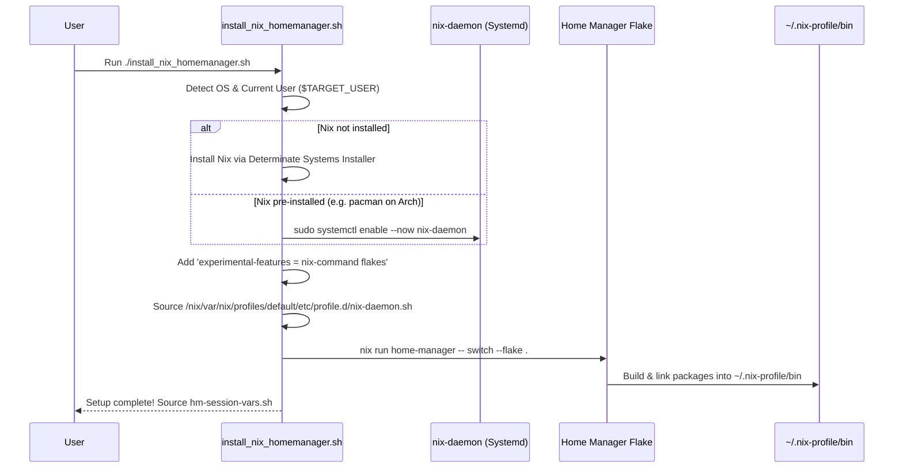

# Comprehensive Beginner's Guide & Line-by-Line Explanation of Nix

This document walks through the Nix configuration files in this repository in logical order. If you have little to no prior experience with the Nix language, Flakes, or Home Manager, this guide is designed to explain not just **what** each line does, but **why** the syntax looks the way it does.

---

## Table of Contents
1. [Core Concepts: What are Nix, Flakes, and Home Manager?](#1-core-concepts-what-are-nix-flakes-and-home-manager)
2. [Nix Language Syntax Primer (Crash Course)](#2-nix-language-syntax-primer-crash-course)
3. [File 1: `nix-home-manager/flake.nix` (The Entry Point)](#3-file-1-nix-home-managerflakenix-the-entry-point)
4. [File 2: `nix-home-manager/home.nix` (The User Environment)](#4-file-2-nix-home-managerhomenix-the-user-environment)
5. [File 3: `nix-home-manager/flake.lock` (The Reproducibility Anchor)](#5-file-3-nix-home-managerflakelock-the-reproducibility-anchor)
6. [How It All Connects with `install_nix_homemanager.sh`](#6-how-it-all-connects-with-install_nix_homemanagersh)
7. [Day-to-Day Cheat Sheet](#7-day-to-day-cheat-sheet)

---

## 1. Core Concepts: What are Nix, Flakes, and Home Manager?

Before reading the code, it helps to understand the three distinct layers at play:

```
┌────────────────────────────────────────────────────────┐
│  Home Manager                                          │  Declarative configuration of your user home
│  (programs, tools, dotfiles in ~/.nix-profile)         │  directory and CLI packages.
├────────────────────────────────────────────────────────┤
│  Nix Flakes                                            │  Standardized project specification with pinned
│  (flake.nix & flake.lock)                              │  dependencies, inputs, and outputs.
├────────────────────────────────────────────────────────┤
│  The Nix Language & Store                              │  Pure functional language engine and immutable store
│  (/nix/store/<hash>-package-name)                      │  isolated from host system libraries.
└────────────────────────────────────────────────────────┘
```

1. **Nix (The Language & Package Manager)**: 
   Unlike standard package managers (`apt`, `pacman`) that overwrite binaries in `/usr/bin`, Nix builds every piece of software into its own unique directory in `/nix/store/` with a cryptographic hash of all its inputs (e.g. `/nix/store/d8f...-ripgrep-14.1.0/bin/rg`). This means packages never conflict, and installations cannot break your host OS.
2. **Nix Flakes**: 
   A modern feature of Nix that brings standard dependency locking (like `package-lock.json` or `Cargo.lock`). A flake specifies explicit **inputs** (external repositories like `nixpkgs`) and **outputs** (what packages or configurations it builds).
3. **Home Manager**: 
   A system built on Nix specifically for managing a user's `$HOME` directory without needing root permissions. It installs packages and links config files to your user profile (`~/.nix-profile/bin`).

---

## 2. Nix Language Syntax Primer (Crash Course)

Nix is **not** a general-purpose programming language like Python or Bash. It is a **pure, functional data declaration language** (similar to JSON or YAML, but with functions and variables).

Here are the 6 syntax rules you need to know:

| Syntax | Example | Meaning |
|---|---|---|
| **Attribute Set** | `{ a = 1; b = "text"; }` | Key-value dictionary. Notice: assignments use `=`, entries end with semicolons `;` (not commas!). |
| **List** | `[ 1 2 "apple" pkgs.git ]` | Ordered list. Elements are separated by whitespace (no commas!). |
| **Function** | `x: x + 1` | A function taking argument `x` and returning `x + 1`. The colon `:` separates arguments from the body. |
| **Pattern Matching** | `{ a, b, ... }: a + b` | A function expecting an attribute set with keys `a` and `b`. `...` means "ignore extra keys". |
| **`let ... in`** | `let x = 10; in x * 2` | Declares local variables before the `in` expression. |
| **`inherit`** | `inherit a b;` | Shortcut for `a = a; b = b;`. Copies variables into an attribute set. |
| **Fallback `or`** | `pkgs.foo or null` | If `pkgs.foo` exists, use it; otherwise use `null`. |
| **Interpolation** | `"${username}"` | String interpolation (like template literals in JS or f-strings in Python). |

---

## 3. File 1: `nix-home-manager/flake.nix` (The Entry Point)

`flake.nix` is the manifest of your configuration. It defines where dependencies come from and what configurations this flake exposes.

Here is the file explained line-by-line:

```nix
1: {
2:   description = "Reproducible Home Manager CLI environment";
```
- **Line 1 (`{`)**: Flakes are always written as a single top-level Nix attribute set.
- **Line 2 (`description = ...;`)**: A human-readable description of what this flake provides.

---

### The `inputs` Block (Dependencies)

```nix
4:   inputs = {
5:     nixpkgs.url = "github:nixos/nixpkgs/nixos-25.05";
6:     nixpkgs-unstable.url = "github:nixos/nixpkgs/nixpkgs-unstable";
7:     home-manager = {
8:       url = "github:nix-community/home-manager/release-25.05";
9:       inputs.nixpkgs.follows = "nixpkgs";
10:     };
11:   };
```
- **Line 4 (`inputs = { ... };`)**: Declares external Git repositories that this flake depends on.
- **Line 5 (`nixpkgs.url = "github:nixos/nixpkgs/nixos-25.05";`)**: 
  Specifies the official Nix package repository, pinned to the stable `25.05` release channel. This is where 95% of your tools come from.
- **Line 6 (`nixpkgs-unstable.url = "github:nixos/nixpkgs/nixpkgs-unstable";`)**: 
  Also brings in the bleeding-edge "unstable" channel. This acts as a fallback for brand-new terminal tools (like `ghostty`, `matugen`, `lazysql`) that might not yet exist in the stable release.
- **Lines 7–10 (`home-manager = { ... };`)**: 
  Brings in Home Manager pinned to `release-25.05`.
  - **Line 9 (`inputs.nixpkgs.follows = "nixpkgs";`)**: 
    **Crucial optimization.** By default, Home Manager would download its own separate copy of `nixpkgs`. `follows` tells Home Manager: *"Use the exact same `nixpkgs` defined on line 5"*, preventing duplicate downloads and disk waste.

---

### The `outputs` Function (Building the Config)

```nix
13:   outputs = { self, nixpkgs, nixpkgs-unstable, home-manager, ... }@inputs:
```
- **Line 13**: 
  - `outputs` is a function that receives all resolved `inputs` declared above.
  - `{ self, nixpkgs, ... }`: Deconstructs specific inputs so we can reference them directly.
  - `@inputs`: Binds the entire inputs set as a variable named `inputs` so we can pass all of it down easily.
  - The colon `:` marks the start of the function body.

```nix
14:     let
15:       system = "x86_64-linux";
16:       pkgs = nixpkgs.legacyPackages.${system};
17:       pkgs-unstable = nixpkgs-unstable.legacyPackages.${system};
```
- **Line 14 (`let`)**: Begins a block of local helper variables.
- **Line 15 (`system = "x86_64-linux";`)**: Defines the target architecture (standard 64-bit Intel/AMD Linux).
- **Line 16 (`pkgs = nixpkgs.legacyPackages.${system};`)**: 
  Extracts the complete collection of packages for `x86_64-linux` from the stable `nixpkgs` input into a shorthand variable called `pkgs`.
- **Line 17 (`pkgs-unstable = nixpkgs-unstable.legacyPackages.${system};`)**: 
  Same as above, but for the unstable channel.

---

### The `mkHomeConfig` Function Helper

```nix
19:       mkHomeConfig = username: home-manager.lib.homeManagerConfiguration {
20:         inherit pkgs;
21:         extraSpecialArgs = {
22:           inherit inputs pkgs-unstable username;
23:         };
24:         modules = [
25:           ./home.nix
26:         ];
27:       };
```
- **Line 19 (`mkHomeConfig = username: ...`)**: 
  Defines a reusable function that takes a `username` string (e.g. `"zacsek"`) and calls Home Manager's configuration generator (`home-manager.lib.homeManagerConfiguration`).
- **Line 20 (`inherit pkgs;`)**: 
  Passes our evaluated stable package set to Home Manager. Equivalent to writing `pkgs = pkgs;`.
- **Lines 21–23 (`extraSpecialArgs = { ... };`)**: 
  Allows us to pass custom variables into `home.nix`. We pass:
  - `inputs`: The flake inputs.
  - `pkgs-unstable`: The unstable package set so `home.nix` can fall back to it.
  - `username`: The name of the user being configured.
- **Lines 24–26 (`modules = [ ./home.nix ];`)**: 
  Tells Home Manager where our user configuration file is (`./home.nix`).

---

### Exporting `homeConfigurations`

```nix
28:     in {
29:       homeConfigurations = {
30:         "zacsek" = mkHomeConfig "zacsek";
31:         "default" = mkHomeConfig "default";
32:       };
33:     };
34: }
```
- **Line 28 (`in {`)**: Finishes the `let` block and returns the final flake output attribute set.
- **Line 29 (`homeConfigurations = { ... };`)**: 
  Special output recognized by Home Manager. When you run `home-manager switch --flake .#zacsek`, Home Manager looks inside `outputs.homeConfigurations.zacsek`.
- **Lines 30–31**: 
  Generates configurations for `"zacsek"` and a `"default"` fallback using our `mkHomeConfig` helper function.

---

## 4. File 2: `nix-home-manager/home.nix` (The User Environment)

`home.nix` defines everything that belongs to your user account: username, state version, and the packages to install.

### Function Arguments and the `getPkg` Fallback Helper

```nix
1: { config, pkgs, pkgs-unstable ? pkgs, username ? "zacsek", ... }:
2: 
3: let
4:   # Helper to resolve packages from pkgs, falling back to pkgs-unstable, or null
5:   getPkg = name: pkgs.${name} or pkgs-unstable.${name} or null;
6: in
```
- **Line 1**: 
  `home.nix` is a function! Home Manager calls this function and injects:
  - `config`: The full system configuration state.
  - `pkgs`: The stable package set passed from `flake.nix`.
  - `pkgs-unstable ? pkgs`: The unstable package set passed via `extraSpecialArgs`. The `? pkgs` part means: *"if not provided, default to `pkgs`"*.
  - `username ? "zacsek"`: The target username, defaulting to `"zacsek"`.
  - `...`: Ignores any other internal arguments Home Manager passes.
- **Lines 3–5 (`let getPkg = name: ... in`)**: 
  This is a safety helper function.
  - `pkgs.${name}` tries to look up `name` in stable packages.
  - `or pkgs-unstable.${name}` tries to look up `name` in unstable packages if stable does not have it.
  - `or null` returns `null` if the package does not exist in either channel.
  - **Why this matters**: In Nix, referencing a non-existent package like `pkgs.foo` causes an immediate build failure (`attribute 'foo' missing`). With `getPkg "foo"`, it safely evaluates to `null`.

---

### Home Environment Variables

```nix
7: {
8:   home.username = username;
9:   home.homeDirectory = if pkgs.stdenv.isDarwin then "/Users/${username}" else "/home/${username}";
10:   home.stateVersion = "25.05";
```
- **Line 8**: Sets the username dynamically based on the passed argument.
- **Line 9**: Sets the user's home directory path (`/home/username` on Linux, `/Users/username` on macOS).
- **Line 10 (`home.stateVersion = "25.05";`)**: 
  Tells Home Manager what release defaults to use. You generally do not change this after creation to avoid unexpected configuration migrations.

---

### The `home.packages` List

```nix
15:   home.packages = builtins.filter (p: p != null) [
```
- **Line 15**: 
  - `home.packages = [ ... ];` is the list of software that will be built and linked into `~/.nix-profile/bin/`.
  - `builtins.filter (p: p != null) [ ... ]`: Filters the list to remove any `null` values. Remember how `getPkg` returns `null` if a package isn't found? This filter cleans those out so Nix only builds valid packages.

Let's look at how the packages are declared:

#### Direct Stable Packages
```nix
19:     pkgs.cargo
20:     pkgs.rustc
21:     pkgs.nodejs
...
37:     pkgs.zsh
38:     pkgs.bash
39:     pkgs.atuin
```
- Refers directly to packages in the official stable Nixpkgs repository (`pkgs.<package-name>`).

#### Using the `getPkg` Fallback Helper
```nix
52:     (getPkg "ghostty")
61:     (getPkg "opencode")
83:     (getPkg "yazi")
90:     (getPkg "lazysql")
```
- Packages wrapped in `(getPkg "...")` use our fallback resolver. If `ghostty` or `yazi` is newer than stable `25.05`, Nix will fetch it from `pkgs-unstable` instead of failing.

#### Using Inline `or` Fallbacks
```nix
67:     (pkgs.bat-extras.batman or null)
104:    (pkgs.nodePackages.prettier or pkgs.prettier or null)
146:    (pkgs.netcat-gnu or pkgs.netcat or null)
```
- Some packages change names between releases (e.g. `prettier` moving from `pkgs.nodePackages.prettier` to top-level `pkgs.prettier`).
- This pattern checks the first attribute path; if missing, checks the second; if missing, falls back to `null` (which `builtins.filter` then safely removes).

---

### Self-Management

```nix
170:   # Let Home Manager install and manage itself
171:   programs.home-manager.enable = true;
172: }
```
- **Line 171 (`programs.home-manager.enable = true;`)**: 
  Enables the `home-manager` command-line tool itself to be managed by Nix, making the `home-manager` CLI available directly in your terminal.

---

## 5. File 3: `nix-home-manager/flake.lock` (The Reproducibility Anchor)

Whenever you build or update a flake, Nix automatically generates `flake.lock`.

### What is it?
Just like `package-lock.json` in Node or `Cargo.lock` in Rust, `flake.lock` records the **exact Git commit hash** and **content hash** (`narHash`) of each input repository.

Here is a snippet from `flake.lock`:
```json
"nixpkgs": {
  "locked": {
    "lastModified": 1762756533,
    "narHash": "sha256-HiRDeUOD1VLklHeOmaKDzf+8Hb7vSWPVFcWwaTrpm+U=",
    "owner": "nixos",
    "repo": "nixpkgs",
    "rev": "c2448301fb856e351aab33e64c33a3fc8bcf637d",
    "type": "github"
  }
}
```

### Why is this important?
- When you run `./install_nix_homemanager.sh` on Ubuntu, Arch, or Fedora 6 months from now, Nix will not fetch "whatever happens to be latest today".
- It downloads the **exact commit** (`c2448301...`).
- This guarantees bit-for-bit reproducibility: every machine running this flake receives the exact identical binaries, compilers, and dependencies.

---

## 6. How It All Connects with `install_nix_homemanager.sh`

The script [`install_nix_homemanager.sh`](file:///home/zacsek/.dotfiles/install_nix_homemanager.sh) ties these files together with the operating system:



1. **Step 1 (Daemon)**: Ensures the background multi-user build daemon (`nix-daemon`) is running so you can build packages without permission errors.
2. **Step 2 (Flakes)**: Enables modern flake evaluation (`nix-command flakes`).
3. **Step 3 (Bootstrap)**: Uses `nix run github:nix-community/home-manager/release-25.05` to run Home Manager without needing it pre-installed.
4. **Step 4 (Switch)**: Evaluates `flake.nix` -> loads `home.nix` -> compiles/downloads all packages -> symlinks them into `~/.nix-profile/bin/`.

---

## 7. Day-to-Day Cheat Sheet

Once Nix is installed, you don't need to touch `install_nix_homemanager.sh` again. Here is how you interact with your environment:

### Adding a New CLI Tool
1. Open [`nix-home-manager/home.nix`](file:///home/zacsek/.dotfiles/nix-home-manager/home.nix).
2. Add the package to `home.packages` (e.g. `pkgs.htop` or `(getPkg "htop")`).
3. Apply the changes:
   ```bash
   home-manager switch --flake ~/.dotfiles/nix-home-manager
   ```

### Searching for Packages
To check what a package is called in nixpkgs:
```bash
nix search nixpkgs <tool-name>
```
*(Or search via web: [search.nixos.org](https://search.nixos.org/packages))*

### Updating All Pinned Tools
To upgrade all packages to the newest commit in their channel:
```bash
cd ~/.dotfiles/nix-home-manager
nix flake update
home-manager switch --flake .
```

### Rolling Back
If a package update breaks something, you can instantly roll back to your previous generation:
```bash
home-manager generations
home-manager switch --generation <NUMBER>
```
Nix keeps past generations in `/nix/store/`, allowing atomic, zero-downtime rollbacks!
